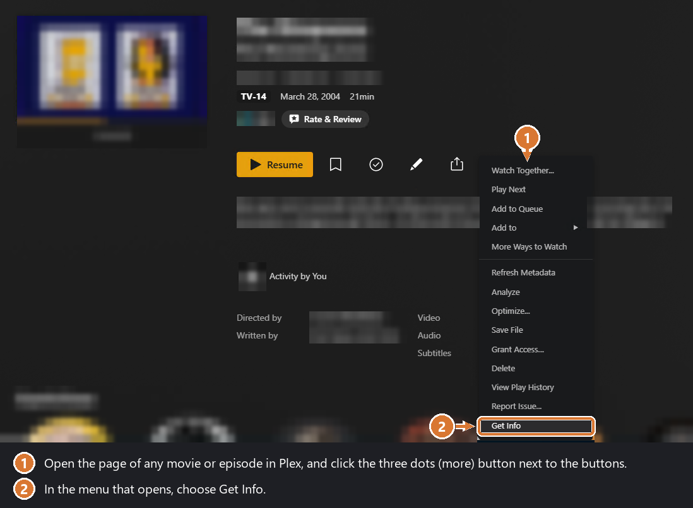
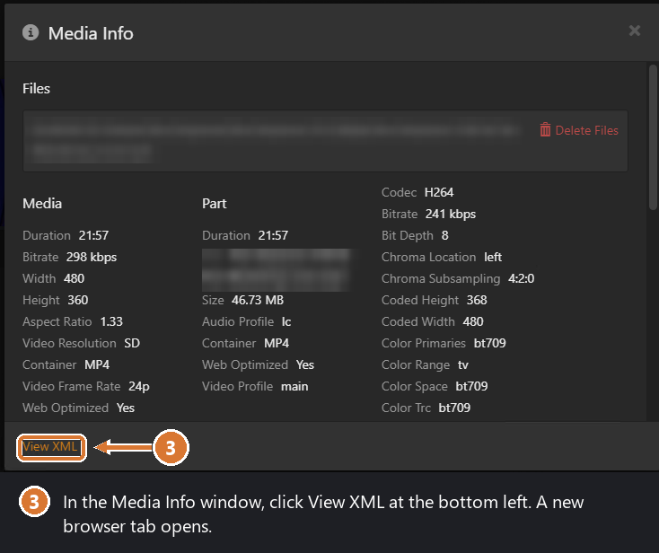
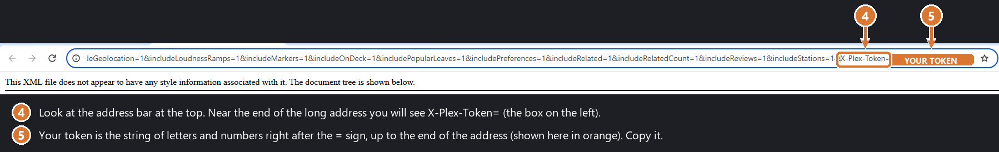

# Moving your watch history to Khylo

If you're coming from Plex (or another server), Khylo can bring everyone's history across: what they've watched, where they
stopped, the music they play and their favorites. Nothing newer in Khylo is ever replaced, so it's safe to run more than once.

You do this inside Khylo, in the dashboard, after your libraries have been added and scanned. It matches by what the titles
are, so Khylo needs to have found your movies, shows and music first.

## Before you start

- **Keep your old server running** until the import is finished. Khylo reads from it.
- **Your old server must be reachable from the Khylo server** (usually the same home network). You need two things from it:
  its **address** and a **token** (a long password-like code that lets Khylo look at the history).
- **Treat the token like a password.** Don't post it or send it to anyone. If you think it got out, sign out of all devices
  from your Plex account's security settings, which stops old tokens working.

## Step 1: Get your Plex address

It's the address you type into a browser to reach your Plex server, followed by `:32400`. For example
`http://192.168.1.10:32400`. Use the number for the computer that runs Plex (the same one you use to open Plex at home).

## Step 2: Get your Plex token

Do this in a web browser on the computer where you use Plex, signed in to Plex as the **server owner**. The owner's token lets
Khylo see everyone in your Plex Home, not just you.

**2a. Open the three-dots menu.** Open the page of any movie or episode in Plex. Click the three dots (more) button next to
the Resume and bookmark buttons, then choose **Get Info**.

**2b. Click View XML.** In the **Media Info** window that opens, click **View XML** at the bottom left. A new browser tab
opens with a page of code. Don't worry about what's on it.

**2c. Copy the token from the address bar.** Look at the address bar at the top of that new tab. Near the end of the long
address you'll see `X-Plex-Token=`. Your token is the string of letters and numbers right after the `=` sign, up to the end
of the address. Select just that part and copy it. (The orange box in the picture covers the token. Yours will be a real,
different string of letters and numbers.)

Tip: if the address is too long to see the end, click in the address bar and press **End**.

## Step 3: Connect Khylo to Plex

1. In Khylo, open the **Dashboard**, then **Import Watch History**.
2. Under **1. Connect**, leave **Plex** chosen.
3. Type your Plex address in **Server address**, and paste the token into **Plex token**.
4. Click **Connect**. Khylo finds the people on your Plex server.

If it says it can't connect, check that the address is right, that Plex is running, and that the Khylo server can reach it
(try opening the Plex address in a browser on the Khylo computer).

## Step 4: Choose who goes where

Under **2. Who goes where**, each person on Plex is listed. For each one, choose the Khylo user or home profile that should
receive their history. Leave anyone on **Don't import** to skip them. If a Plex user has a PIN, you'll be asked for it.

## Step 5: Preview, then import

1. Click **Preview** first. Khylo shows how much of each person's history it can match, as a percentage, without changing
   anything.
2. If it looks right, click **Import**.
3. When it finishes, each person shows a result. Click **Details** to see anything Khylo couldn't match. Usually that's a title
   that isn't in your Khylo libraries yet, or one that's named differently.

A lower match is normal if your libraries aren't all added yet. Add them, let Khylo scan, and run the import again: it only
adds what's missing.

## Moving from another server instead

Choose **Another server** in step 1. You'll need its address (for example `http://192.168.1.10:8096`) and an **API key**:
on that server, open its dashboard, go to **API Keys**, and add one for Khylo. Then carry on from step 3.

## Troubleshooting

- **"Can't connect":** check the address (including the port number), that the old server is on, and that there's no
  firewall between the two computers.
- **Only some people show up:** use the server owner's token. A token from a regular user only shows that user.
- **Low match percentage:** your Khylo libraries may not be fully scanned yet, or some titles are in folders Khylo hasn't been
  given. Add them, wait for the scan, and import again.
- **Something went wrong halfway:** run it again. It never replaces newer history in Khylo, so repeating is safe.

More help: [troubleshooting](troubleshooting.md).
